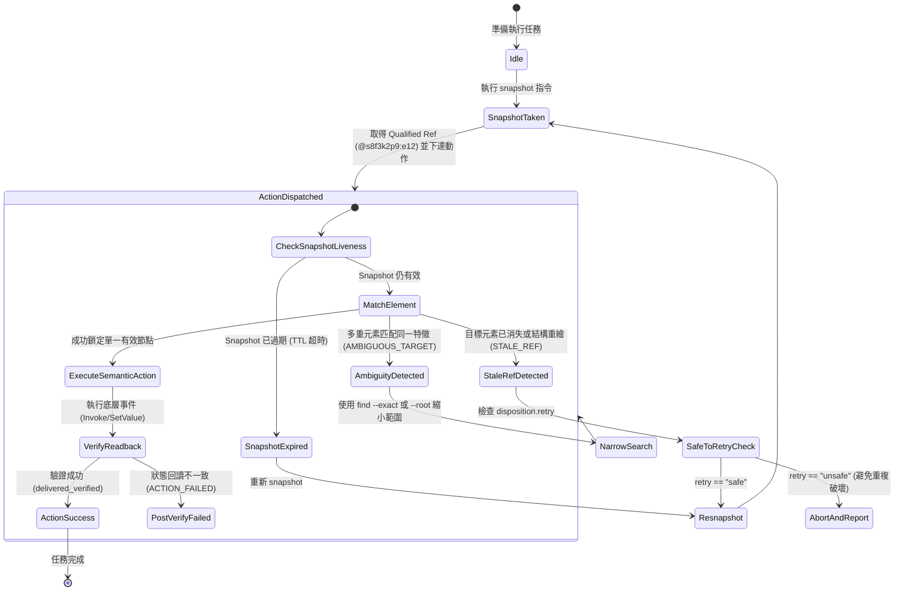

# OS 級 Computer Use 架構規格書：Accessibility Tree 無障礙樹、命名空間 Ref 與無像素匹配設計手冊

- **文件版本**：1.0.0
- **生效日期**：2026-11-01
- **架構依據**：Vercel Labs `agent-desktop`（Rust Core）與各作業系統原生無障礙 API
- **適用範圍**：全系統 AI Agent（Antigravity、Claude Code、Codex、Hermes）之跨平台桌面 GUI 自動化操作
- **核心主張**：揚棄高成本脆弱的視覺截圖猜座標迴圈（Visual Loop），轉為以作業系統原生無障礙樹（Accessibility Tree）為核心的語意化操控架構。

---

## 1. 執行摘要與架構範式轉移

### 1.1 傳統視覺 Computer Use 的三大致命瓶頸

自 2024 年底 Anthropic 推出 Computer Use 方案以來，以視覺模型（VLM）為主的桌面操作迴圈主導了早期實踐。其流程為：
`全螢幕截圖` $\to$ `多模態模型辨識` $\to$ `預測 (x, y) 像素座標` $\to$ `模擬實體滑鼠移動與點擊` $\to$ `二次截圖驗證`。

此模式在生產環境中暴露了三大難以克服的結構性瓶頸：
1. **Token 消耗極端昂貴（Token Burn Rate）**：
   單張高解析度截圖（如 1080p 或 4K 縮放）消耗 1,000 至 1,800 Input Tokens。連續 10 次互動即耗費 1.5 萬至 2 萬 Tokens，極易耗盡配額並觸發模型 Rate Limits。
2. **座標漂移與環境抗噪性低（Coordinate Fragility）**：
   DPI 縮放變化、動畫延遲、視窗陰影、排版重排或臨時彈跳通知，均會導致像素座標預測偏差。一旦點擊偏移，輕則落空，重則誤觸「刪除」或「送出」等破壞性按鈕。
3. **螢幕焦點搶占與操作干擾（Screen Hijacking）**：
   視覺方案強制要求目標視窗位於最上層（Foreground），並移動硬體指標，致使使用者無法在同一台機器上正常工作，亦無法支援多工並行。

### 1.2 `agent-desktop` 的無障礙樹架構破局

作業系統（Windows / macOS / Linux）早已為讀屏軟體（Screen Readers）建立了深層的語意無障礙樹（Accessibility Tree）。該樹狀結構具備精確的控制項型別（Role）、名稱（Name）、值（Value）、互動狀態（States）與語意操作呼叫（Invoking Actions）。

透過直讀無障礙樹，Agent 不再「看圖猜座標」，而是「讀取結構化 DOM 並發送語意事件」：

| 評估指標 | 傳統視覺截圖方案（Pixel Matching） | 語意無障礙樹方案（agent-desktop a11y） | 效益對比 |
| :--- | :--- | :--- | :--- |
| **Token 消耗 / 步** | 1,000 ~ 1,800 Tokens（圖像） | 80 ~ 200 Tokens（JSON 樹，骨架模式 < 50） | **節省 90% ~ 95%** |
| **執行延遲** | 3,000 ~ 5,000 ms（多模態推論） | 10 ~ 50 ms（原生 OS API 呼叫） | **延遲降低 98%** |
| **定位精確度** | 像素近似估計，易受縮放干擾 | 元素唯一的語意 Ref，100% 精確打擊 | **零座標漂移** |
| **焦點需求** | 必須置頂前景，搶佔實體滑鼠 | 預設 Headless 非搶佔，背景平靜操作 | **不干擾使用者工作** |
| **錯誤處置** | 無法判斷是否點中，只能再截圖猜測 | 原生支援 `STALE_REF` 與重試合約 | **確定性狀態反饋** |

---

## 2. 跨作業系統原生節點模型與映射

`agent-desktop` 在 Rust 底層將三大作業系統的無障礙與視窗階層抽象為統一的資料結構：

```text
               ┌────────────────────────────────────────────────────────┐
               │           Unified Accessibility Node Model             │
               │  - id: String (@<snapshot_id>:<ref_id>)                │
               │  - role: Role (button, text_field, window, menu...)    │
               │  - name: String                                        │
               │  - value: Option<String>                               │
               │  - states: Set<State> (focused, disabled, checked...)   │
               │  - bounds: Rect { x, y, width, height }                │
               │  - actions: Vec<Action> (click, type, toggle, scroll)  │
               └───────────────────────────┬────────────────────────────┘
                                           │
         ┌─────────────────────────────────┼────────────────────────────────┐
         ▼                                 ▼                                ▼
┌──────────────────┐             ┌──────────────────┐             ┌──────────────────┐
│   Windows UIA    │             │   macOS AX API   │             │   Linux AT-SPI   │
│ UI Automation    │             │ AXUIElementCopy  │             │ D-Bus org.a11y   │
│ IUIAutomation    │             │ Command Host     │             │ AtspiAccessible  │
└──────────────────┘             └──────────────────┘             └──────────────────┘
```

### 2.1 Windows 平台：UI Automation (UIA) 與 WindowStation 隔離

1. **核心技術棧**：
   - 透過 `IUIAutomation` 與 Win32 API 存取頂層與子控制項。
   - 控制項模式（Control Patterns）：`InvokePattern`（點擊）、`ValuePattern`（設定文字）、`TogglePattern`（核取方塊）、`ScrollPattern`（滾動）。
   - 無需管理員提權：在標準使用者權限下，只要介面 Integrity Level 相符即可操作，僅對系統保護層（如 UAC 畫面、Secure Desktop）拒絕存取。
2. **深度實證：WindowStation 與 Desktop 隔離防禦**：
   - **實證現象**：當 Agent 在某些背景服務、IDE 衍生子終端（如 `exebox-...`）環境運行時，程序可能被指派至專屬的虛擬 Desktop。在此狀態下直接呼叫 `EnumWindows` 會返回 0 個視窗且錯誤代碼為 0。
   - **底層原理**：Windows 透過 Window Station（如 `WinSta0`）與 Desktop（如 `default`）進行視窗與輸入事件隔離。
   - **加固解法**：在需要枚舉完整桌面視窗時，必須於乾淨的 Thread 呼叫 `OpenDesktop("default", ...)` 並透過 `SetThreadDesktop` 切換至互動式桌面，方能枚舉全系統頂層視窗（經實機驗證可達 600+ 視窗無死角）。

### 2.2 macOS 平台：Accessibility API 與 Command Host

- 透過 `AXUIElement` 家族 API 與系統輔助引擎互動。
- 具備專屬的 Command Host 程序，避免物件生命週期在非同步垃圾回收或程序釋放時出現懸空指標。
- 支援標準 Application Menu、Sheet 與 Notification Center 語意表面。

### 2.3 Linux 平台：AT-SPI2 D-Bus 引擎

- 基於 `at-spi2-core`，透過 D-Bus 協定與桌面應用（GTK、Qt 等）溝通。
- 支援 X11 與 Wayland 工作階段（Session）。

---

## 3. 命名空間 Ref（Namespace Refs）演算法與生命週期

### 3.1 Ref 編碼規範

為杜絕傳統自動化工具隨意猜測 Selector 或使用無效的全域索引，`agent-desktop` 採用嚴格的命名空間 Ref：
$$\text{Ref} = \text{\texttt{@<snapshot\_id>:<ref\_id>}}$$

例如：`@s8f3k2p9:e12`
- `snapshot_id`（例：`s8f3k2p9`）：代表某一次 Snapshot 的 8 位元雜湊指紋。每次產生樹快照時，依當前時間戳與樹節點幾何生成唯一識別碼。
- `ref_id`（例：`e12`）：代表該快照中第 12 個具備可操作性的語意節點（靜態容器與純裝飾文本不賦予 Ref，以節省 Token）。

### 3.2 PowerShell 單引號跳脫安全合約

在 Windows PowerShell 環境下，`@identifier` 是語言保留的 **Splatting 展開運算子**。
- **錯誤寫法**：`agent-desktop click @s8f3k2p9:e12` $\to$ PowerShell 會誤將 `@s8f3k2p9:e12` 解釋為雜湊表變數並清除，導致 CLI 收到空參數拋出 `INVALID_ARGS`。
- **強制規範**：所有 Agent 在 Windows 下呼叫含 Ref 的指令時，**必須一律使用單引號包裹**：
  ```powershell
  agent-desktop click '@s8f3k2p9:e12'
  agent-desktop set-value '@s8f3k2p9:e5' 'Hello World'
  ```

---

## 4. 過期檢測（`STALE_REF`）與歧義（`AMBIGUOUS_TARGET`）狀態機



### 4.1 狀態定義與錯誤防呆

1. **`STALE_REF`**：
   - 觸發情境：在 Agent 取得快照與下達點擊指令之間，UI 發生非同步重繪（例如彈窗關閉、清單刷新、分頁切換）。
   - 防禦原則：CLI 絕不嘗試在原地隨機尋找鄰近或相似控制項，而是立即中斷並回傳 `STALE_REF`，保障點擊絕對安全。
2. **`AMBIGUOUS_TARGET`**：
   - 觸發情境：在動態視窗中，同一特徵比對到多個同名且同角色的並列節點。
   - 處置策略：提示 Agent 透過 `--root @<snapshot_id>:<container_id>` 限制搜尋範圍，或改用精準名稱匹配。
3. **`SNAPSHOT_NOT_FOUND`**：
   - 觸發情境：快照識別碼已超過本地 Session 快取保留期限。Agent 必須發起全新觀察。

---

## 5. 處置合約（Disposition Retry Contract）與冪等性安全

所有 `agent-desktop` 命令回傳標準 JSON Envelope：
```json
{
  "version": "2.5",
  "ok": false,
  "command": "click",
  "error": {
    "code": "STALE_REF",
    "message": "Element @s8f3k2p9:e12 is no longer valid in current tree",
    "disposition": {
      "delivery": "not_delivered",
      "retry": "safe"
    }
  }
}
```

### 5.1 投遞狀態（Delivery Status）矩陣

| `delivery` 欄位值 | 物理/語意意義 | 是否已對系統產生副作用 | 重試安全性 (`retry`) |
| :--- | :--- | :--- | :--- |
| `not_delivered` | 指令在送達目標元件前即被攔截（如參數無效、Ref 過期、視窗最小化） | 否（100% 無副作用） | `safe`（可安全重試） |
| `delivered_verified` | 動作已送達，且事後回讀驗證確認狀態已改變（例如核取方塊已勾選） | 是（已生效） | 無需重試 |
| `delivered_unverified` | 動作已送達底層訊息佇列，但目標元件未實作回讀屬性以確認結果 | 可能已生效 | **`unsafe`（嚴禁盲目重試）** |

### 5.2 嚴禁 Doom Loop 重試守則

1. 僅當 `error.disposition.retry == "safe"` 時，Agent 才被允許重新快照並重試。
2. 當 `disposition.retry == "unsafe"` 時（如扣款、發信、提交表單操作）：
   - Agent **嚴禁在迴圈中連續嘗試點擊**。
   - 必須退回觀察階段，呼叫 `get` 或 `snapshot` 重新研判目前真實狀態；若無法確認，應立即主動向人類使用者求助。

---

## 6. 密集介面優化策略：骨架速描與區域下鑽

當面對大型應用（如 IDE、複雜 ERP、瀏覽器內大量 DOM 節點）時，完整快照可能包含數千個節點。為維持極致 Token 效率，採用兩段式漸進觀察：

```text
  [第 1 階段：骨架速描]
  agent-desktop snapshot --skeleton --app "Code" -i --compact
  └── 回傳頂層架構與主要區域容器，折疊子節點並標註 children_count (消耗 ~40 tokens)
                                 │
                                 ▼ 鎖定目標容器 @s8f3k2p9:e4 (例: 側邊欄檔案列表)
  [第 2 階段：區域下鑽]
  agent-desktop snapshot --root '@s8f3k2p9:e4' -i --compact
  └── 僅下鑽展開該容器內的子節點與操作 Ref (消耗 ~60 tokens)
```

1. **`--skeleton`（骨架模式）**：
   僅渲染視窗頂層容器與主要控制面（Containers），子分支予以剪枝並標記 `children_count`。
2. **`--root '@<snapshot_id>:<ref_id>'`（區域下鑽）**：
   將快照範圍嚴格限制於指定容器之內，快速定位微小元件，大幅壓縮上下文體積。
3. **`--compact`**：
   移除贅餘空格與空屬性，將 JSON 密度提升至最高。

---

## 7. 驗證與合規宣告

本規格書所定義之語意快照、Ref 解析演算法、PowerShell 防雷跳脫規範、STALE_REF 狀態機與重試安全合約，已於 `ai-inbox/tools/verify_a11y_tree_snapshot.py` 與 `ai-inbox/tests/test_verify_a11y_tree_snapshot.py` 取得完整單元測試驗證，並全面納入跨 Agent 共用規範。
