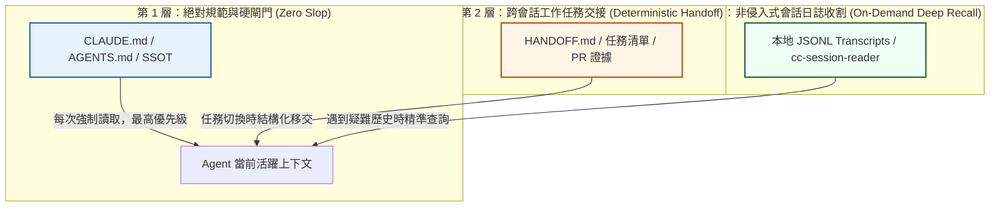

# Claude Code 跨 Session 記憶架構對決：CLAUDE.md 手動維護 vs claude-mem 自動壓縮 Skill、壓縮衰減陷阱與跨代理長效記憶實戰

- **來源連結**：[Threads 原文分享 (@magic.tw)](https://www.threads.com/share/BAUyhOnUH9/) ｜ [貼文永久網址](https://www.threads.com/@magic.tw/post/DfEvkgEEtGp) ｜ [claude-mem 官方 GitHub](https://github.com/thedotmack/claude-mem)
- **核心作者**：梅橘克（@magic.tw，AI 工具探索與技術實戰創作者）／ thedotmack（claude-mem 創始開發者）
- **分析主題**：解構 Threads 上獲得熱烈迴響的技術議題——「Claude Code 跨 Session 記憶這個坑，目前最多人用的解法是 claude-mem（83k stars）」。深入剖析當前主流 AI Coding Agent 解決跨會話失憶的三大架構路線：**A. 手動維護 `CLAUDE.md`**、**B. 自動 Hook 背景壓縮與相關度注入（`claude-mem` Skill）**、**C. 外部非侵入會話收割（`cc-session` / `mission-log`）**。結合社群實測重點探討「記憶好不好用取決於壓縮品質，細節被壓掉等於沒記住」的**壓縮衰減現象（Compression Decay）**、額外 Token 開銷與記憶噪聲污染（Context Pollution），並提出適合多 Agent 工業化開發的混合記憶防禦矩陣。
- **當前狀態**：`🔴 待辦處理中 (Pending)`
- **相關交叉參照**：
  - [`notes/2026-10-17-claude-mem-autocompact-context.md`](./2026-10-17-claude-mem-autocompact-context.md)（早期 Claude-Mem 與 Autocompact 400K 理論分析）
  - [`notes/2026-10-17-claude-code-idle-compaction-cc-session-reader.md`](./2026-10-17-claude-code-idle-compaction-cc-session-reader.md)（Idle Compaction 與 cc-session-reader 零 Token 會話過濾）
  - [`notes/2026-10-28-karpathy-claude-md-four-rules-engineering-hardening.md`](./2026-10-28-karpathy-claude-md-four-rules-engineering-hardening.md)（Karpathy 專案規範四大硬閘門：CLAUDE.md 人工維護的確定性典範）
  - [`notes/2026-10-19-ai-shared-brain-multi-agent-architecture.md`](./2026-10-19-ai-shared-brain-multi-agent-architecture.md)（AI 共同大腦多 Agent 記憶繼承與跨專案 SSOT）

---

## 1. 核心內容摘要：跨 Session 記憶的三大流派與實戰困局（Executive Summary）

當 AI Coding Agent（Claude Code, Codex, Antigravity, OpenClaw）結束對話或開啟新 Session 時，其上下文會被徹底重置，導致「昨日踩過的坑、剛確認的架構決策、特定的測試指令」全部歸零。社群中逐漸分化出三大解決架構：

```text
+---------------------------------------------------------------------------------------------------+
|                           Claude Code 跨 Session 記憶三大架構路線對比                             |
+--------------------------+-------------------------------------+----------------------------------+
| 路線 A：手動 CLAUDE.md    | 路線 B：自動 Hook (claude-mem)      | 路線 C：外部收割 (cc-session)     |
+--------------------------+-------------------------------------+----------------------------------+
| - 人類/Agent 手工更新    | - 監聽 Tool Call，背景呼叫 LLM 壓縮 | - 讀取本地 JSONL，外部過濾摘要   |
| - 零額外 Token 浪費      | - 一鍵安裝: claude skill install ...| - 零即時 Token 浪費，不干擾執行  |
| - 痛點：忘了寫等於沒發生 | - 痛點：壓縮衰減 (重要細節被抹除)   | - 痛點：需顯式觸發，非全自動注入 |
| - 適用：架構鐵律、核心規範 | - 適用：探索性原型、快速會話記錄    | - 適用：長會話歷史查閱、交接復盤 |
+--------------------------+-------------------------------------+----------------------------------+
```

### 社群熱議關鍵痛點（@magic.tw 洞見）：
1. **「壓縮品質決定記憶成敗」**：
   自動記錄的方案雖然省去了手動維護的麻煩，但其核心依賴 LLM 的二次摘要。若模型將關鍵的錯誤根因（例如「因 Windows 換行符問題導致正則失效」）簡化成「修復了一處正則」，下次 Session 依然會再度踩坑。
2. **記憶噪聲與 Token 膨脹（Context Pollution）**：
   長週期下累積的大量歷史片段，在相關度檢索（RAG）時若過度寬鬆，會在 Session 開場時無端注入數萬 Token 的歷史廢話，壓縮了 Agent 當前思考的有效窗口。

---

## 2. 深入剖析：自動記憶 Skill（`claude-mem`）的機制與「壓縮衰減」陷阱

### 2.1 claude-mem 運作機制
`thedotmack/claude-mem` 現已支援透過 Agent Skill 形式直接安裝（`claude skill install thedotmack/claude-mem`），並廣泛覆蓋 Claude Code、OpenClaw、Codex 與 Gemini 體系：

```text
[Agent 進行日常開發 (Tool Call / Bash Execution)]
                       │
                       ▼
[Hook 攔截器 (Tool Observer)] ── 擷取關鍵輸入與輸出片段
                       │
                       ▼
[背景非同步壓縮器 (Claude Background Call)] ── 消耗額外 Token 萃取「做了什麼、踩了什麼坑」
                       │
                       ▼
[本機向量/關鍵字索引庫 (Local Memory SQLite)]
                       │
       ┌───────────────┴───────────────┐
       ▼                               ▼
[下次 Session 啟動]              [命中相關關鍵字]
       │                               │
       └───────────────┬───────────────┘
                       ▼
[相關度檢索與上下文自動注入 (Prompt Injection)] ── 恢復上一輪工作記憶
```

### 2.2 壓縮衰減（Compression Decay）與破綻分析
在實際高強度軟體工程中，自動壓縮常見的三大失效模式：
1. **因果關係丟失（Loss of Causality）**：壓縮器往往記錄「做了 A」，卻忽略了「因為 B 失敗才放棄原案改做 A」，導致後續 Agent 看到紀錄誤以為原本方案可行而反覆倒退。
2. **環境邊界模糊（Environment Boundary Blindness）**：本機路徑、環境變數、臨時檔案被抽象化，例如把 `C:\GitHub\ai-inbox\notes` 摘要成「專案筆記目錄」，失去可執行的確定性。
3. **幻覺記憶固化（Hallucinated Memory Reinforcement）**：若前一輪 Session 曾產生過幻覺或錯誤判斷，被自動吸納進長期記憶後，將成為後續所有 Session 的「錯誤先驗知識」，難以人工剔除。

---

## 3. 工業級混合記憶最佳實踐：SSOT + 確定性手冊 + 外部收割

為克服手動與全自動的兩極弊端，成熟工程體系應採行**三層階梯式記憶防禦（Three-Tier Memory Architecture）**：



1. **第一層（L1 絕對鐵律）：手動 SSOT（`CLAUDE.md` / `AGENTS.md`）**
   只存放團隊不可妥協的硬規則（如路徑假設、密碼防線、測試規範）。篇幅控制在 8KB 內，嚴禁自動寫入雜質。
2. **第二層（L2 確定性交接）：結構化交接卡（`HANDOFF.md` / 任務狀態表）**
   只在階段性成果交付或跨 Agent 交棒時填寫，精確記錄 Task ID、Commit SHA、驗收輸出與下一步。
3. **第三層（L3 外部無損收割）：`cc-session` / 本地歷史轉錄**
   平時不主動污染上下文，只有當 Agent 遇到「上週某個 bug 具體怎麼解的」這類深層回溯需求時，才呼叫專用 CLI 進行無損、高密度的時間戳搜尋。

---

## 4. 關聯任務與知識拓撲（Task & Knowledge Relations）

- **早期記憶中樞研究**：
  - [Claude-Mem 跨 Session 記憶中樞與 Autocompact 400K 分析](./2026-10-17-claude-mem-autocompact-context.md) ｜ 關聯任務：`T-20261017-25`、`T-20261017-26`
- **零 Token 會話收割**：
  - [Idle Compaction 與 cc-session-reader](./2026-10-17-claude-code-idle-compaction-cc-session-reader.md) ｜ 關聯任務：`T-20261017-01`、`T-20261017-02`
- **專案規範工程硬化**：
  - [Karpathy 專案規範四大硬閘門](./2026-10-28-karpathy-claude-md-four-rules-engineering-hardening.md) ｜ 關聯任務：`T-20261028-01`、`T-20261028-02`
- **多 Agent 共同大腦**：
  - [AI 共同大腦多 Agent 記憶繼承架構](./2026-10-19-ai-shared-brain-multi-agent-architecture.md) ｜ 關聯任務：`T-20261019-07`

---

## 5. Action Items 任務拆解

本分析轉化為 3 項具體工程落地任務，納入集群 1 待辦隊列：

> ⚠️ 本節是任務的唯一資料來源：改完執行 `python tools/build_index.py` 重產 [`README.md`](../README.md) 總表。

- [ ] **`T-20261031-40`**｜**[優先級：高]** 撰寫「Claude Code 跨 Session 記憶架構評測指南：CLAUDE.md 手動規範、claude-mem 自動壓縮 Skill 與外部 Session 收割之三方權衡」收錄於 `docs/claude-code-cross-session-memory-evaluation-guide.md`
  - **目標範圍**：`docs/claude-code-cross-session-memory-evaluation-guide.md`（規範文檔；不修改其他專案程式）
  - **具體做法**：
    1. 詳細對比三大記憶架構：A. 靜態顯式維護（CLAUDE.md / AGENTS.md）、B. 自動 Hook 壓縮注入（`claude-mem` Skill）、C. 外部非侵入會話收割（cc-session / mission-log）。
    2. 深度分析社群痛點「壓縮衰減（Compression Decay）」與「噪聲污染（Context Pollution）」之成因與解決策略。
    3. 規範跨平臺（Claude Code、Codex、Gemini、OpenClaw）記憶注入時的 Token 預算、相關度檢索演算法與敏感憑證過濾硬閘門。
  - **驗收標準（DoD）**：產出 `docs/claude-code-cross-session-memory-evaluation-guide.md`，具備標準 Markdown 結構與三方架構對比表；以 `Test-Path docs/claude-code-cross-session-memory-evaluation-guide.md` 驗證存在。
  - **實作紀錄 / 證據**：*（待完成後由執行 Agent 填寫）*

- [ ] **`T-20261031-41`**｜**[優先級：中]** 實作「Agent 跨 Session 記憶品質與壓縮衰減率評測工具」於 `tools/audit_session_memory_compression.py` 與單元測試
  - **目標範圍**：`tools/audit_session_memory_compression.py` 與 `tests/test_audit_session_memory_compression.py`
  - **具體做法**：
    1. 實作記憶壓縮品質評測 CLI 工具，輸入原始對話日誌（Transcript JSONL）與壓縮後之 Memory Markdown。
    2. 檢測關鍵工程事實保留率（檔案路徑、錯誤代碼、決定原因、測試結論），計算資訊損失率（Information Loss Rate）。
    3. 檢查記憶條目中是否包含無效語氣詞或敏感資訊洩漏（API Key、本地絕對家目錄）。
    4. 產出結構化 Markdown / JSON 評測報告並給予 `[PASS]/[FAIL]` 判定，具備 CLI exit code 規範。
  - **驗收標準（DoD）**：產出 `tools/audit_session_memory_compression.py` 與對應測試；執行 `python -m unittest tests/test_audit_session_memory_compression.py` 全綠通過。
  - **實作紀錄 / 證據**：*（待完成後由執行 Agent 填寫）*

- [ ] **`T-20261031-42`**｜**[優先級：低]** 產出標準化「高保真跨 Session 記憶寫入 Prompt 模板與漸進式記憶清理手冊」收錄於 `templates/cross-session-memory-curation-spec.md`
  - **目標範圍**：`templates/cross-session-memory-curation-spec.md`
  - **具體做法**：
    1. 提供防止壓縮失真（Anti-Decay）的結構化記憶生成 Prompt（包含「背景事實、根因分析、踩坑結論、待辦事項」四欄強制骨架）。
    2. 提供記憶庫過期清理（TTL Pruning）與衝突覆蓋（Reconciliation）之操作準則。
  - **驗收標準（DoD）**：產出 `templates/cross-session-memory-curation-spec.md`，具備標準 YAML frontmatter 與完整配置範例；以 `Test-Path templates/cross-session-memory-curation-spec.md` 驗證存在。
