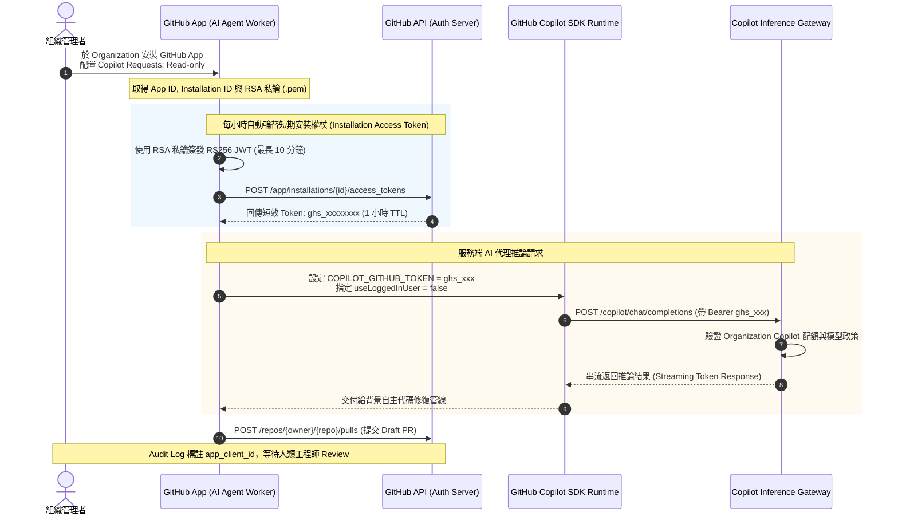

# GitHub Copilot 支援 GitHub Apps Server-to-Server 服務端認證解構：解耦工程師個人 Token、Workload-Owned 系統身分、最小權限隔離與自主 Agent 無人值守 SDLC 實戰

- **來源連結**：[Threads 原文分享 (@it.oppa.twhk)](https://www.threads.com/share/_juQRw3Bl/) ｜ [貼文永久網址](https://www.threads.com/@it.oppa.twhk/post/DfEikz9DWOv) ｜ [GitHub Changelog 官方公告 (2026-10-27)](https://github.blog/changelog/2026-10-27-github-copilot-supports-server-to-server-authentication/) ｜ [GitHub Apps 認證官方文檔](https://docs.github.com/en/apps/creating-github-apps/authenticating-with-a-github-app)
- **核心作者**：it.oppa.twhk（@it.oppa.twhk，軟體架構與 AI 實戰創作者）／ GitHub Copilot 產品架構團隊
- **分析主題**：解構 GitHub 於 2026 年 10 月 27 日正式發布的重大架構更新——**GitHub Copilot 正式支援 Organization GitHub Apps 的「Server-to-Server (S2S)」服務端認證機制（Public Preview）**。深入剖析此項功能如何徹底打破過去 AI Coding Agent（如 Copilot SDK、背景修蟲 Bot、CI/CD 掃描器）必須寄生於「個別工程師個人帳號與 Personal Access Token (PAT)」的結構性瓶頸，賦予 AI 代理人專屬的 **Workload-Owned 系統組織身分**。結合社群架構師（@alicken、@ginsengtrycatch）的深度討論，探討最小權限隔離（Least-Privilege）、短期動態 Token 交換（1 小時 TTL）、企業稽核追蹤（`app_client_id`）與夜間自主「無人值守 SDLC（Unattended SDLC）」的安全防護與回滾邊界。
- **當前狀態**：`🔴 待辦處理中 (Pending)`
- **相關交叉參照**：
  - [`notes/2026-10-28-karpathy-claude-md-four-rules-engineering-hardening.md`](./2026-10-28-karpathy-claude-md-four-rules-engineering-hardening.md)（Karpathy 專案規範四大硬閘門：最小權限、環境隔離與確定性防線）
  - [`notes/2026-10-28-thorsten-ball-how-i-work-with-agents-2026.md`](./2026-10-28-thorsten-ball-how-i-work-with-agents-2026.md)（Thorsten Ball 15 條實戰哲學：爆破半徑審查、不可反駁證據與人類最終裁決）
  - [`notes/2026-10-23-zeabur-october-2026-security-incident.md`](./2026-10-23-zeabur-october-2026-security-incident.md)（Zeabur 資安事件反思：本地 OAuth 憑證洩漏教訓與憑證生命週期輪替）
  - [`notes/2026-10-17-cross-cli-subagent-orchestration-space-bunny.md`](./2026-10-17-cross-cli-subagent-orchestration-space-bunny.md)（跨 CLI 外包與多 Agent 協同調度管道）

---

## 1. 核心內容摘要：問題背景與架構典範轉移（Executive Summary）

長期以來，在企業與開源專案中運行自主 AI Coding Agent 面臨著巨大的安全與營運矛盾：

```text
【過去模式：寄生於人類開發者身分】
+-----------------------+      (綁定個人 PAT: ghp_xxx)      +-------------------------+
| 個別工程師 (John Doe) | ───────────────────────────────► | 背景自主 AI Agent 腳本   |
+-----------------------+                                   +------------+------------+
  - 離職 / 調職 ──► Token 被註銷 ──► 背景代理全面癱瘓                    |
  - Token 外洩 ──► 駭客取得 John Doe 全部 GitHub 權限                    v
  - Audit Log  ──► 代理提交的代碼在歷史上記錄為 "John Doe"    [呼叫 GitHub Copilot API]
                   無法溯源是人類還是 AI 所為                 (缺少系統級治理與計費分離)

===================================================================================

【現代模式：Workload-Owned 系統組織身分 (S2S)】
+--------------------------+                                +-------------------------+
| Organization GitHub App  |                                | 背景自主 AI Agent 服務  |
|  (專屬身分 / 私鑰簽名)   |                                |  (Copilot SDK Runtime)  |
+------------+-------------+                                +------------+------------+
             |                                                           |
             | 1. JWT 簽名交換 (App Private Key)                          |
             | 2. 獲取短期權杖 (ghs_xxx, 1h TTL, 最小權限)               |
             +───────────────────────────────────────────────────────────+
                                         |
                                         v 3. 呼叫 Copilot API
+-------------------------------------------------------------------------------------+
| GitHub Copilot 雲端服務端 (S2S 認證)                                                 |
|  - 組織權限: Copilot Requests: Read-only                                            |
|  - 稽核報告: 獨立追蹤 app_client_id，清晰分離人類與 AI 呼叫                           |
|  - 治理預算: 組織級集中配額控管；一鍵 Suspend App 即刻熔斷                           |
+-------------------------------------------------------------------------------------+
```

### 社群熱議焦點（Threads 架構討論精粹）：
1. **解除心理負擔與脆弱依賴**（[@alicken](https://www.threads.com/@alicken)）：
   「這更新解掉的不是單一痛點，是整個代理部署的心理負擔。以前很多人不敢真放手，不是模型不會做，是 token 綁在人身上太脆弱，換人、過期、外洩都直接炸掉。現在有正式系統身分，代理才比較像真的服務，而不是借來跑的實驗品。」
2. **釐清過往 GitHub Apps 的認知盲區**（[@ginsengtrycatch](https://www.threads.com/@ginsengtrycatch) vs [@it.oppa.twhk](https://www.threads.com/@it.oppa.twhk)）：
   過往 GitHub Apps 雖具備 Git/REST API 的機器身分，但**其產生的 Access Token 無法存取 GitHub Copilot 推論端點**（Copilot 過去強制綁定人類使用者的付費 Seat / User Token）。本次更新正式新增了組織層級的 **`Copilot Requests: Read-only`** 權限，首次打通了 Copilot SDK 的純服務端（Server-to-Server）管線。
3. **無人值守 SDLC 的真正考驗**：
   自動在夜間抓蟲、跑測試、發 PR 固然令人振奮，但架構設計的關鍵從來不是「能否發 PR」，而是「審核防線、爆破半徑（Blast Radius）與回滾（Rollback）機制是否切得乾淨」。

---

## 2. 系統架構與 S2S 認證技術全景（Technical Architecture）

### 2.1 權限與憑證交換生命週期（Authentication Lifecycle）



### 2.2 核心安全機制與對比矩陣

| 維度 | 舊機制：個人存取權杖（PAT / User Token） | 新機制：GitHub App S2S 認證（2026-10-27） |
| :--- | :--- | :--- |
| **身分歸屬（Identity）** | 個人工程師（Human User Seat） | 組織工作負載（Workload-Owned Identity） |
| **生命週期（TTL）** | 長效（30~90 天，甚至無期限） | 短效動態權杖（1 小時自動過期，JWT 簽名現領） |
| **離職／人事變動** | 人員離開或密碼輪替即全面失效 | 與個人解耦，組織持續穩定維運 |
| **權限控制（Least-Privilege）** | 權限過寬（全庫讀寫，外洩災難高） | 細粒度分配（限定 repo、限定 `Copilot Requests`） |
| **安全審計（Auditing）** | Audit Log 混同於個人操作 | 獨立 `app_client_id`，AI 操作 100% 可溯源 |
| **熔斷機制（Kill-Switch）** | 必須修改或刪除個人 Token，影響工程師本人 | 組織管理後台一鍵「Suspend/Uninstall App」，立即生效 |
| **CI/CD 原生相容** | 必須在 Secret 中注入明文個人 Token | GitHub Actions 內建 `GITHUB_TOKEN` 支援 `copilot-requests: write` |

---

## 3. 夜間自主 Agent（Unattended SDLC）的安全工程防線

讓 AI 代理人在夜間無人值守自主抓蟲並發送 PR，必須建立在「確定性安全防禦」之上，嚴防 AI 幻覺或有害指令污染主分支：

```text
[夜間排程觸發 (Cron / Webhook)]
              │
              ▼
[S2S 認證交換 (1h 短期 ghs_xxx)]
              │
              ▼
[沙盒隔離環境 (Ephemeral Runner)] ── 執行測試套件、定位 Bug
              │
              ▼
[Copilot SDK 程式碼修復] ── 呼叫 LLM 產生外科手術式最小修復 (Surgical Fix)
              │
              ▼
[本地品質門檻 (Quality Gates)] ── 必須 100% 綠燈 (Linter, Unit Tests, TypeCheck)
       │              │
    (紅燈)          (綠燈)
       │              │
       ▼              ▼
   [終止並報警]    [提交至獨立分支 (fix/ai-agent-xxx)]
                      │
                      ▼
               [發布 Draft Pull Request] ◄── 嚴禁直接 Merge！
                      │
                      ├─► 標記 app_client_id 與 [AI-Agent-Generated] 標籤
                      ├─► 附帶完整測試輸出截圖與無可辯駁證據
                      └─► 等待隔日晨會人類工程師審核 (Human-in-the-Loop)
```

### 四大工程鐵律：
1. **分支保護嚴禁繞過（Branch Protection）**：主分支（`main`/`release`）必須啟用保護規則，AI App 絕對不可具備 `bypass_pull_request_allowances` 權限。
2. **強制以 Draft PR 提交**：AI 產出的變更一律標註為草稿（Draft PR），並明確附上 Reproduce 腳本、Diff 影響範圍與單元測試報告。
3. **爆破半徑封鎖（Blast Radius Containment）**：透過 CI 腳本檢查，若變更範圍涉及核心架構設定（如 `.github/workflows`、`Dockerfile`、Terraform、支付模組），直接拒絕提交並發送警報。
4. **一鍵回滾機制（Automated Rollback）**：所有由 AI 提交的分支與 commit 必須具備標準原子化（Atomic）結構，確保 `git revert` 可乾淨還原。

---

## 4. 關聯任務與知識拓撲（Task & Knowledge Relations）

- **架構硬化與專案規範**：
  - [Karpathy 專案規範四大硬閘門](./2026-10-28-karpathy-claude-md-four-rules-engineering-hardening.md) ｜ 關聯任務：`T-20261028-01`、`T-20261028-02`
- **確定性交付與 SDLC 審查**：
  - [Thorsten Ball 15 條實戰哲學](./2026-10-28-thorsten-ball-how-i-work-with-agents-2026.md) ｜ 關聯任務：`T-20261028-04`、`T-20261028-05`
- **雲端資安事件與憑證審查**：
  - [Zeabur 遭黑客攻擊事件反思：本地 OAuth 憑證與專案隔離](./2026-10-23-zeabur-october-2026-security-incident.md) ｜ 關聯任務：`T-20261023-05`、`T-20261023-06`
- **多代理外包與調度中樞**：
  - [跨 CLI 外包與多 Agent 協同調度管道](./2026-10-17-cross-cli-subagent-orchestration-space-bunny.md) ｜ 關聯任務：`T-20261017-31`

---

## 5. Action Items 任務拆解

本分析轉化為 3 項具體工程落地任務，納入集群 1 待辦隊列：

> ⚠️ 本節是任務的唯一資料來源：改完執行 `python tools/build_index.py` 重產 [`README.md`](../README.md) 總表。

- [ ] **`T-20261031-25`**｜**[優先級：高]** 撰寫「GitHub Apps Server-to-Server 與 Copilot SDK 工作負載身分整合實戰指南：權限配置、短期 Token 交換與夜間無人值守 SDLC」收錄於 `docs/github-apps-s2s-copilot-workload-identity-guide.md`
  - **目標範圍**：`docs/github-apps-s2s-copilot-workload-identity-guide.md`（規範文檔；不修改其他專案程式）
  - **具體做法**：
    1. 詳盡規範 Organization GitHub App 的建立步驟與最小授權原則（`Copilot Requests: Read-only`、`Pull Requests: Write`、`Issues: Write`、`Contents: Write`，排除組織管理高危權限）。
    2. 深度拆解基於 RSA Private Key 生成 JWT 並交換 1 小時短期安裝權限 Token（Installation Access Token `ghs_...`）的密鑰輪替流程。
    3. 規範 Copilot SDK（Node.js / Python）在背景無人值守作業下的呼叫介面（`useLoggedInUser: false`、環境變數 `COPILOT_GITHUB_TOKEN` 注入）。
    4. 定義夜間自主 Agent PR 提交的安全防線（受保護分支不可繞過、強制真人 Review、自動化測試 Gate、一鍵撤回與 Rollback 流程）。
  - **驗收標準（DoD）**：產出 `docs/github-apps-s2s-copilot-workload-identity-guide.md`，具備標準 Markdown 結構與 S2S 認證流程圖；以 `Test-Path docs/github-apps-s2s-copilot-workload-identity-guide.md` 驗證存在。
  - **實作紀錄 / 證據**：*（待完成後由執行 Agent 填寫）*

- [ ] **`T-20261031-26`**｜**[優先級：中]** 實作「GitHub App S2S 憑證規格檢驗與權限邊界審查工具」於 `tools/audit_github_app_s2s_spec.py` 與單元測試
  - **目標範圍**：`tools/audit_github_app_s2s_spec.py` 與 `tests/test_audit_github_app_s2s_spec.py`
  - **具體做法**：
    1. 實作靜態配置與 Manifest 檢查 CLI 工具，讀取 GitHub App Manifest 設定檔（JSON / YAML）或 App 權限清單。
    2. 驗證是否宣告新版 `copilot_requests` 權限、是否杜絕超限高危權限（如 `administration: write`、`members: write`）、檢查 Token TTL 與 Private Key 格式合規性。
    3. 支援環境變數模擬檢測，確保 `COPILOT_GITHUB_TOKEN` 不含個人 PAT 特徵（排除 `ghp_` 開頭，必須為 `ghs_` 安裝權杖）。
    4. 產出結構化 JSON/Markdown 審查報告並給予 `[PASS]/[FAIL]` 判定，具備 CLI exit code 規範。
  - **驗收標準（DoD）**：產出 `tools/audit_github_app_s2s_spec.py` 與對應測試；執行 `python -m unittest tests/test_audit_github_app_s2s_spec.py` 全綠通過。
  - **實作紀錄 / 證據**：*（待完成後由執行 Agent 填寫）*

- [ ] **`T-20261031-27`**｜**[優先級：低]** 產出標準化「GitHub App S2S 認證封裝腳本與無人值守 Agent GitHub Actions 工作流範本」收錄於 `templates/github-app-s2s-agent-workflow.md`
  - **目標範圍**：`templates/github-app-s2s-agent-workflow.md`
  - **具體做法**：
    1. 提供標準 Bash / Python 短權杖交換腳本範本（讀取 App ID 與 Private Key 產出短期 `ghs_` Token）。
    2. 提供開箱即用的 GitHub Actions 工作流（Workflow）範例，展示在 CI/CD 中以 Workload-Owned 系統身分啟動夜間維護 Agent 自動分析 issue、提交修復分支與 Draft PR。
  - **驗收標準（DoD）**：產出 `templates/github-app-s2s-agent-workflow.md`，具備標準 YAML frontmatter 與完整配置代碼；以 `Test-Path templates/github-app-s2s-agent-workflow.md` 驗證存在。
