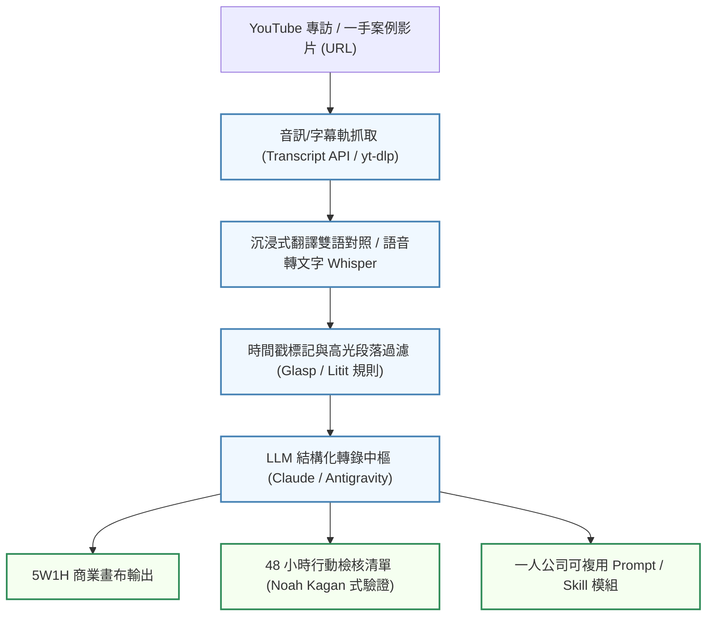

# 海外一手副業與一人商業案例解構：Starter Story、Noah Kagan 48小時驗證、Justin Welsh複利矩陣與影音字幕情報萃取管線

- **來源連結**：[Threads 原文分享 (@inxtool)](https://www.threads.com/share/BAXj9ByWpM/) ｜ [貼文永久網址](https://www.threads.com/@inxtool/post/DfETUMDEoFO) ｜ [Starter Story 官方案例庫 (starterstory.com)](https://www.starterstory.com/) ｜ [Noah Kagan YouTube 頻道](https://www.youtube.com/@noahkagan) ｜ [Justin Welsh 個人站 (justinwelsh.me)](https://www.justinwelsh.me/)
- **核心作者**：臺大玩AI（@inxtool，專注 AI 工具探索、數位遊牧與一人副業案例實戰）
- **分析主題**：解構 Threads 獲得 62,000+ 瀏覽、1,100+ 轉發收藏的高價值分享——「一般人做副業，別看國內互相洗腦的付費課，直接走向全球一手案例與影音情報萃取體系」。深入剖析四大國際級一人商業（Solopreneurship）指標人物與平台（**Starter Story、Noah Kagan、Justin Welsh、Brett Malinowski**）的核心商業模型與冷啟動路徑；同時梳理基於 **沉浸式翻譯（Immersive Translate）**、**Glasp**、**Litit** 與 YouTube Transcript 轉錄技術的自動化影音情報採掘管線，將非結構化長影片轉化為可執行的 48 小時商業驗證畫布。
- **當前狀態**：`🔴 待辦處理中 (Pending)`
- **相關交叉參照**：
  - [`notes/2026-10-31-dan-koe-digital-artisan-body-of-work-framework.md`](./2026-10-31-dan-koe-digital-artisan-body-of-work-framework.md)（Dan Koe 數位匠人一人公司：作品集閉環與思想博物館）
  - [`notes/2026-10-17-agent-reach-social-intelligence.md`](./2026-10-17-agent-reach-social-intelligence.md)（Agent-Reach 多平台情報採掘與跨網探針）
  - [`notes/2026-10-17-academic-reading-framework.md`](./2026-10-17-academic-reading-framework.md)（5W1H / CQR / KSU 文獻研讀架構：從學術論文遷移至商業案例拆解）
  - [`notes/2026-10-28-feedback-desk-ai-agent-client-ticketing-handoff.md`](./2026-10-28-feedback-desk-ai-agent-client-ticketing-handoff.md)（Productized Services 產品化服務工單與一人高客單價交付）

---

## 1. 核心內容摘要：破除二手焦慮走向一手世界（Executive Summary）

在華語社群中，副業與副業培訓常陷入「二手資訊倒賣、販售同質焦慮、同溫層互相洗腦」的割韭菜循環。創作者 @inxtool 提出的核心洞察在於**破除資訊差，直面全球一手開放案例**：

```text
[華語二手副業同溫層]
   - 二手翻譯拼湊 / 割韭菜課程 / 虛假獲利截圖
   - 陷入 "學習工具 -> 焦慮 -> 買課 -> 繼續焦慮" 閉環
               │
               ▼ (典範轉移：一手情報採掘)
[全球一手副業真實案例矩陣]
 ├── Starter Story (5,000+ 小型專案真實營收複盤、財務指標公開)
 ├── Noah Kagan (AppSumo 創辦人 / 48 小時極速預售驗證)
 ├── Justin Welsh (頂級一人商業 IP 受眾矩陣與內容複利)
 └── Brett Malinowski (AI Agency、海外高客單產品化服務與數位遊牧)
               │
               ▼ (工具賦能：跨語言零摩擦吸收)
[影音情報自動化萃取管線]
 ├── 沉浸式翻譯 (網頁、PDF、YouTube 雙語字幕即時對照)
 └── Glasp / Litit / Transcript API (時間戳高光提取、5W1H 商業畫布轉錄)
```

---

## 2. 四大國際一人商業（Solopreneur）案例庫深度剖析

```text
+-------------------+--------------------------------------------------------------------+
| 指標人物 / 平台   | 核心架構與實戰路徑                                                 |
+-------------------+--------------------------------------------------------------------+
| 1. Starter Story  | 專注「微型創業（Bootstrapping）」真實複盤：                        |
|    (Pat Walls)    | - 收錄 5,000+ 微型專案從 $0 到年入百萬美元完整過程                 |
|                   | - 100% 透明公開：起步靈感、MVP 驗證、獲客管道（Acquisition）、     |
|                   |   月營收拆解（MRR Breakdown）與犯錯教訓                           |
|                   | - 核心啟示：極度垂直利基市場（Niche Market）遠勝過大而全的平庸產品   |
+-------------------+--------------------------------------------------------------------+
| 2. Noah Kagan     | 《Million Dollar Weekend》48 小時極速變現法：                      |
|    (AppSumo)      | - 核心公式：Idea -> Ask -> Pre-sell -> Build                       |
|                   | - 嚴禁未驗證即寫代碼：要求在 48 小時內向 3 位真實客戶預收訂金       |
|                   | - 克服拒絕恐懼（Ask for Money）：以極低啟動資金跑通變現閉環         |
+-------------------+--------------------------------------------------------------------+
| 3. Justin Welsh   | 一人商業受眾矩陣與複利飛輪（The Diversified Creator）：            |
|                   | - 內容飛輪：頂層社群觸及（LinkedIn/X）-> 中層高信任電子報 ->       |
|                   |   底層 $150 高毛利自託管數位資產（Build Once, Sell Twice）          |
|                   | - 系統化流程：將日常工作成果模板化，單人維運超過 90% 營業利益率     |
+-------------------+--------------------------------------------------------------------+
| 4. Brett          | AI 產品化服務（Productized AI Services）與海外高客單價業務：       |
|    Malinowski     | - 將 AI Agent / 自動化工作流包裝為固定月費服務（$2k~$5k/mo）       |
|                   | - 善用數位遊牧槓桿：賺取歐美主流貨幣（USD/EUR），於低成本地區生活   |
+-------------------+--------------------------------------------------------------------+
```

---

## 3. 影音情報自動化萃取管線（Video Intelligence Pipeline）

將長篇 YouTube 專訪與一手案例轉化為可落地執行的工程規格，依賴結構化的情報萃取架構：



### 情報萃取標準輸出欄位（Case Study Schema）：
1. **問題定義（Problem）**：創業者解決了誰的什麼具體痛點？痛點是否具備支付意願？
2. **驗證方式（Validation）**：最初如何在不寫複雜程式碼的情況下獲取第 1 個付費客戶？
3. **獲客漏斗（Acquisition Funnel）**：前 100 個使用者的具體來源（冷郵件、SEO、Product Hunt、社群私訊）。
4. **財務與單位經濟（Unit Economics）**：定價策略（訂閱制 vs 單次買斷）、毛利率、維運成本。
5. **關鍵轉折點（Pivots & Breakthroughs）**：什麼動作觸發了指數型成長？

---

## 4. 關聯任務與知識拓撲（Task & Knowledge Relations）

- **個人數位匠人與一人公司作品集**：
  - [Dan Koe 數位匠人一人公司：作品集閉環與思想博物館](./2026-10-31-dan-koe-digital-artisan-body-of-work-framework.md) ｜ 關聯任務：`T-20261031-04`、`T-20261031-05`
- **社群情報採掘與環境感知**：
  - [Agent-Reach 多平台情報感知探針](./2026-10-17-agent-reach-social-intelligence.md) ｜ 關聯任務：`T-20261017-08`
- **結構化文獻研讀架構**：
  - [5W1H / CQR / KSU 文獻研讀架構](./2026-10-17-academic-reading-framework.md) ｜ 關聯任務：`T-20261017-23`、`T-20261017-24`
- **微型服務產品化交付**：
  - [feedback-desk 產品化服務工單與客戶交接](./2026-10-28-feedback-desk-ai-agent-client-ticketing-handoff.md) ｜ 關聯任務：`T-20261028-07`、`T-20261028-08`

---

## 5. Action Items 任務拆解

本分析轉化為 3 項具體工程落地任務，納入集群 4 待辦隊列：

> ⚠️ 本節是任務的唯一資料來源：改完執行 `python tools/build_index.py` 重產 [`README.md`](../README.md) 總表。

- [ ] **`T-20261031-28`**｜**[優先級：高]** 撰寫「海外一手副業案例拆解與一人商業 48 小時驗證手冊：從 Starter Story 獲客漏斗到 Noah Kagan 預售法則」收錄於 `docs/global-solopreneur-case-study-and-validation-guide.md`
  - **目標範圍**：`docs/global-solopreneur-case-study-and-validation-guide.md`（規範文檔；不修改其他專案程式）
  - **具體做法**：
    1. 深入解構 Starter Story 5,000+ 案例中 Micro-SaaS 與數位產品的獲客閉環（SEO 長尾關鍵字、內容飛輪與冷啟動策略）。
    2. 詳細梳理 Noah Kagan《Million Dollar Weekend》48 小時驗證流程（Idea $\rightarrow$ Ask $\rightarrow$ Pre-sell $\rightarrow$ Build）實戰檢核清單。
    3. 整合 Justin Welsh 一人商業受眾矩陣（頂層社群觸及、中層電子報、底層高槓桿數位資產）與 Brett Malinowski AI 產品化服務包裝標準。
  - **驗收標準（DoD）**：產出 `docs/global-solopreneur-case-study-and-validation-guide.md`，具備標準 Markdown 結構與商業驗證檢核清單；以 `Test-Path docs/global-solopreneur-case-study-and-validation-guide.md` 驗證存在。
  - **實作紀錄 / 證據**：*（待完成後由執行 Agent 填寫）*

- [ ] **`T-20261031-29`**｜**[優先級：中]** 實作「YouTube 影音字幕提取與商業案例精華結構化分析工具」於 `tools/extract_video_case_study.py` 與單元測試
  - **目標範圍**：`tools/extract_video_case_study.py` 與 `tests/test_extract_video_case_study.py`
  - **具體做法**：
    1. 實作影音字幕（SRT / VTT / JSON）或純文本轉錄稿的解析與結構化抽取工具。
    2. 支援從轉錄文本中依時間戳記提取核心要點（問題定義、解決方案、驗證路徑、獲客渠道、財務指標）。
    3. 產出標準 Markdown / JSON 案例萃取報告，並支援輸出可複製的行動步驟（Action Steps）。
  - **驗收標準（DoD）**：產出 `tools/extract_video_case_study.py` 與對應測試；執行 `python -m unittest tests/test_extract_video_case_study.py` 全綠通過。
  - **實作紀錄 / 證據**：*（待完成後由執行 Agent 填寫）*

- [ ] **`T-20261031-30`**｜**[優先級：低]** 產出標準化「一人公司 48 小時極速商業驗證與 Lean Canvas 評估範本」收錄於 `templates/solopreneur-48h-validation-canvas.md`
  - **目標範圍**：`templates/solopreneur-48h-validation-canvas.md`
  - **具體做法**：
    1. 產出專為個人開發者設計的 48 小時極速驗證畫布（包含目標族群痛點、零代碼 MVP 規格、預售價格錨定、3 個種子客戶承諾記錄）。
    2. 提供結合 AI Coding Agent 的快速試水溫與產品著陸頁（Landing Page）規格說明範例。
  - **驗收標準（DoD）**：產出 `templates/solopreneur-48h-validation-canvas.md`，具備標準 YAML frontmatter 與完整商業畫布結構；以 `Test-Path templates/solopreneur-48h-validation-canvas.md` 驗證存在。
