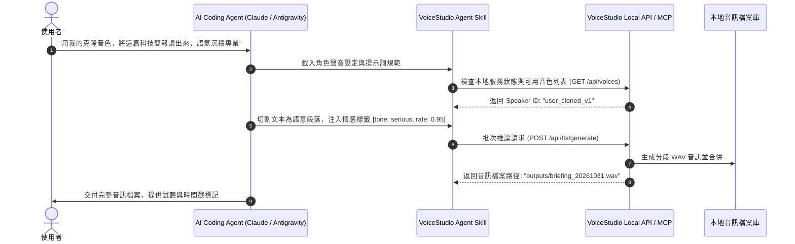

# VoiceStudio 本地開源聲音克隆與 Agent 語音合成管線：零樣本語音復刻、多引擎隔離架構與個人數位分身實踐

- **來源連結**：[Threads 原文短網址](https://www.threads.com/share/_kV_YXEeQ/) ｜ [貼文永久網址](https://www.threads.com/@jenjen69606/post/DfEqylOE3EM) ｜ [創作者主頁 (@jenjen69606)](https://www.threads.com/@jenjen69606) ｜ [VoiceStudio 官方 GitHub](https://github.com/debpalash/VoiceStudio) ｜ [VoiceStudio 官網 (voicestudio.sh)](https://voicestudio.sh/)
- **核心作者**：Jenjen（@jenjen69606，Threads AI 領域實戰創作者）／ Palash Debnath（VoiceStudio 創始開發者）
- **分析主題**：解構 Threads 創作者 Jenjen 實測推薦的開源本地 AI 語音工作台 **VoiceStudio（`debpalash/VoiceStudio`）**。探討其如何作為商業雲端語音服務（如 ElevenLabs）的開源本地化替代方案，透過「零樣本聲音克隆（Zero-Shot Voice Cloning）」、「虛擬環境行程隔離（Subprocess Engine Registry）」、「多引擎動態適配（OmniVoice、CosyVoice、WhisperX 等 16+ TTS / 11+ ASR）」與「Agent Skill 自然語言提示詞驅動」，實現零雲端 API 成本、數據 100% 本地留存、高還原度音色資產化，並與視覺 IP（如 Ann Cheng 16 宮格貼圖）結合打通完整的 AI 數位分身（Avatar）多模態管線。
- **當前狀態**：`🔴 待辦處理中 (Pending)`
- **相關交叉參照**：
  - [`notes/2026-10-31-line-sticker-16-grid-ai-avatar-prompt-spec.md`](./2026-10-31-line-sticker-16-grid-ai-avatar-prompt-spec.md)（Ann Cheng 16 宮格似顏繪貼圖規格：視覺 IP 資產與音色克隆的數位分身整合）
  - [`notes/2026-10-28-motion-design-agent-harness-opus-55.md`](./2026-10-28-motion-design-agent-harness-opus-55.md)（Remotion / WebGL 代碼驅動動效與語音自動配音管線）
  - [`notes/2026-10-17-agent-reach-social-intelligence.md`](./2026-10-17-agent-reach-social-intelligence.md)（Agent-Reach 多平台情報感知探針與社群實戰採掘）
  - [`notes/2026-10-17-cross-cli-subagent-orchestration-space-bunny.md`](./2026-10-17-cross-cli-subagent-orchestration-space-bunny.md)（多 Agent 協同與非同步任務封裝調度）

---

## 1. 核心內容摘要：社群探勘背景與核心技術本質（Executive Summary）

在 Threads 平台短連結 `_kV_YXEeQ`（對應永久網址 `@jenjen69606/post/DfEqylOE3EM`）的探勘過程中，由於 Meta/Threads 平台的安全權限阻擋策略（未攜帶登入憑證的匿名請求返回 `This content isn't available to everyone`），本分析進一步穿透至創作者 Jenjen（@jenjen69606，自述「永远对世界保持好奇」，深耕 #AI 與 Agent 實戰工作流）的主頁公開脈絡，挖掘出其同期的兩大代表性技術實踐：

1. **VoiceStudio 本地聲音克隆與 Agent Skill 整合（核心技術）**：
   - 創作者透過自製 Agent Skill 指揮 AI 代理人，透過引導式 Prompt 完成乾淨音訊採集與特徵提取，調用本地 VoiceStudio 引擎進行高精度聲音克隆。
   - 解決雲端語音服務（如 ElevenLabs）的高昂訂閱費、嚴苛字數上限與個人隱私洩漏問題，實現「本地完全離線推論、額度無限制、音質高保真」。
2. **Grok Bot 5,800+ 模板庫與社群自動化矩陣（配套運營）**：
   - 結合 `botshelf.dev` 模板庫拆解熱門主題與自動生成腳本，串聯聲音克隆管線進行批次音訊故事生成與有聲內容產出。

本筆記聚焦解構 **VoiceStudio（`debpalash/VoiceStudio`）** 的架構本質、模型工程機制、Agent 呼叫協定與自動化音訊管線落地。

---

## 2. VoiceStudio 系統架構與多引擎調度機制（System Architecture）

VoiceStudio 並非單一的模型封裝，而是一個高度模組化的**本地語音作業系統與模型編排引擎**，採用多層解耦與引擎適配器架構：

```text
+-------------------------------------------------------------------------+
|                  使用者介面層 (Desktop Workspace)                        |
|   Electron GUI / Timeline Dubbing / Script Editor / Model Hub UI        |
+------------------------------------+------------------------------------+
                                     |
                                     v
+-------------------------------------------------------------------------+
|                    Agent 通訊與自動化介面 (Integration)                 |
|       Local REST API (FastAPI)     |     Model Context Protocol (MCP)   |
|       Agent Skill Prompt 驅動      |     JSON-RPC 批次任務調度           |
+------------------------------------+------------------------------------+
                                     |
                                     v
+-------------------------------------------------------------------------+
|                 引擎協調器 (Engine Adapter Registry)                     |
|           抽象基底類別 (BaseTTS / BaseASR) 統一輸入輸出規範              |
+------------------+------------------+------------------+----------------+
                   |                  |                  |
                   v                  v                  v
+-------------------------------------------------------------------------+
|            虛擬環境行程隔離層 (Subprocess Environment Isolation)        |
|  [Venv 1: PyTorch 2.4 / CUDA] [Venv 2: MLX Audio] [Venv 3: ONNX Runtime] |
|   - 避免跨模型套件版本衝突 (Transformers / Torchvision / FlashAttention)  |
+------------------+------------------+------------------+----------------+
                   |                  |                  |
                   v                  v                  v
+-------------------------------------------------------------------------+
|                       模型推論核心 (Model Engines)                       |
|   TTS (16+ Engines):                                                    |
|     * OmniVoice (k2-fsa, 現代 Kaldi FSA, 零樣本克隆預設)                 |
|     * CosyVoice (阿里開源, 自然多情感對話語音)                           |
|     * IndexTTS / PocketTTS / KittenTTS (輕量化 CPU 邊緣推論)            |
|   ASR & Alignment (11+ Engines):                                        |
|     * WhisperX (詞級時間戳 + PyAnnote 說話人日誌分離)                    |
|     * Faster-Whisper / MLX-Whisper (Apple Silicon 統一記憶體優化)       |
+-------------------------------------------------------------------------+
```

### 關鍵架構突破點：
1. **虛擬環境行程隔離（Subprocess Environment Isolation）**：
   語音模型領域長期受苦於「相依性地獄（Dependency Hell）」——例如 CosyVoice 可能依賴特定版本的 PyTorch 與 torchaudio，而 WhisperX 則依賴不同版本的 ctranslate2。VoiceStudio 為每個語音引擎建立專屬的獨立 Python 虛擬環境，主程式透過 IPC 子行程管線進行 tensor 與音訊資料傳輸，確保任何單一引擎的升級或崩潰不影響整體系統。
2. **多硬體後端原生適配（Hardware Backends）**：
   - **NVIDIA GPU**：原生 CUDA + PyTorch 2.x 圖編譯（`torch.compile`）優化推論吞吐量。
   - **Apple Silicon**：整合 `MLX-Audio` 與 `MPS (Metal Performance Shaders)`，利用統一記憶體（Unified Memory）實現零拷貝（Zero-Copy）高頻寬運算。
   - **Edge / CPU Fallback**：透過 Sherpa-ONNX 與輕量化 PocketTTS，使無獨立顯卡的輕薄筆電亦能執行基礎語音合成。

---

## 3. 零樣本聲音克隆（Zero-Shot Cloning）與音訊資產工程

### 3.1 零樣本克隆技術流程
相較於傳統需微調（Fine-tuning）數小時的語音模型，VoiceStudio 採用以 **OmniVoice（k2-fsa）** 與語意特徵向量提取為核心的零樣本推論：

```text
[5~15 秒乾淨音訊] 
       │
       ▼
[聲學前處理 (WhisperX / VAD)] ── 移除靜音、環境噪音濾除、正規化至 -20 dBFS
       │
       ▼
[音色特徵編碼器 (Speaker Encoder)] ── 提取 512 維音色嵌入向量 (Voice Embedding)
       │
       ▼
[條件式擴散/自回歸解碼 (OmniVoice Decoder)] ◄── [目標文本 + 語意控制 Prompt]
       │
       ▼
[神經聲碼器 (Neural Vocoder)] ── 產生 24kHz/48kHz 高保真 WAV 波形
```

### 3.2 高還原度克隆音訊採樣規範
為確保克隆效果達到 ElevenLabs 級別，採集樣本須遵循以下黃金標準：
- **長度區間**：5 至 15 秒（過短特徵不充分，過長易引入雜訊與語調漂移）。
- **訊噪比（SNR）**：大於 20 dB，嚴禁環境殘響（Reverb）、回音與背景音樂。
- **語速與語調**：保持自然勻速，避免極端情緒呼喊或耳語。
- **聲學格式**：單聲道（Mono）、無損 WAV、取樣率 $\ge 24\text{ kHz}$、位元深度 16-bit PCM。

---

## 4. Agent Skill 整合：文字指令驅動語音管線

創作者 Jenjen 實證的重大價值在於**將語音工作台封裝為 Agent Skill**。傳統語音軟體需要人工繁瑣拖拉介面，而透過 Agent Skill，LLM 代理人可自動擔任「配音導演與音效工程師」：



---

## 5. 跨專案應用：AI Avatar 數位分身全景矩陣

結合既有專案成果，VoiceStudio 補足了個人 IP 工業化生成的最後一塊拼圖：

| 模態面向 | 核心工具 / 規格 | 產出成果 | 筆記交叉參照 |
| :--- | :--- | :--- | :--- |
| **視覺形象** | Ann Cheng 16 宮格 AI 似顏繪 Prompt | 統一風格的 3D Q版多表情大頭貼與動態貼圖 | [`2026-10-31-line-sticker-16-grid-ai-avatar-prompt-spec.md`](./2026-10-31-line-sticker-16-grid-ai-avatar-prompt-spec.md) |
| **音色復刻** | VoiceStudio 零樣本聲音克隆 | 100% 個人專屬的高還原度離線聲音模型 | **本筆記（VoiceStudio 管線）** |
| **動態演繹** | WebGL Shader / Remotion Code-as-Video | 根據音訊波形自動唇形同步（Lip-sync）與動態演繹 | [`2026-10-28-motion-design-agent-harness-opus-55.md`](./2026-10-28-motion-design-agent-harness-opus-55.md) |
| **大腦決策** | Claude Code / Antigravity Agent Skill | 自動撰寫講稿、排程發布與互動回應 | [`2026-10-17-cross-cli-subagent-orchestration-space-bunny.md`](./2026-10-17-cross-cli-subagent-orchestration-space-bunny.md) |

---

## 6. Action Items 任務拆解

本分析轉化為 3 項具體工程落地任務，納入集群 2 待辦隊列：

> ⚠️ 本節是任務的唯一資料來源：改完執行 `python tools/build_index.py` 重產 [`README.md`](../README.md) 總表。

- [ ] **`T-20261031-22`**｜**[優先級：高]** 撰寫「VoiceStudio 本地 AI 聲音克隆與 Agent 語音管線落地規範：多引擎隔離、零樣本取樣標準與 MCP 整合」收錄於 `docs/voicestudio-local-voice-cloning-spec.md`
  - **目標範圍**：`docs/voicestudio-local-voice-cloning-spec.md`（規範文檔；不修改其他專案程式）
  - **具體做法**：
    1. 制定高品質聲音克隆的音訊採樣黃金標準（採樣率 24kHz/48kHz、訊噪比 SNR > 20dB、無背景音與殘響、語速節奏標準區間 5~15 秒）。
    2. 深度拆解 VoiceStudio 的多引擎隔離機制（Subprocess Engine Registry）與硬體加速調度策略（NVIDIA CUDA、Apple Silicon MLX/MPS、CPU fallback）。
    3. 規範 Agent Skill 驅動 VoiceStudio Local REST API / MCP Server 的標準通訊協定與批次朗讀管線。
  - **驗收標準（DoD）**：產出 `docs/voicestudio-local-voice-cloning-spec.md`，具備標準 Markdown 結構與音訊採樣規範；以 `Test-Path docs/voicestudio-local-voice-cloning-spec.md` 驗證存在。
  - **實作紀錄 / 證據**：*（待完成後由執行 Agent 填寫）*

- [ ] **`T-20261031-23`**｜**[優先級：中]** 實作「本地聲音克隆音訊樣本特徵檢驗與合規審查工具」於 `tools/audit_voice_clone_sample.py` 與單元測試
  - **目標範圍**：`tools/audit_voice_clone_sample.py` 與 `tests/test_audit_voice_clone_sample.py`
  - **具體做法**：
    1. 實作音訊檔案（WAV/MP3/M4A）或語音設定描述檔的靜態與聲學特徵檢查工具（音訊長度 3~30 秒、取樣率、聲道數、音量削波防護、格式完整性）。
    2. 支援從 JSON/YAML 定義檔檢查語音角色設定（角色名稱、參照音訊路徑、目標語言代碼、推論引擎配額）。
    3. 產出結構化 JSON/Markdown 審查報告並給予 `[PASS]/[FAIL]` 判定，具備 CLI exit code 規範。
  - **驗收標準（DoD）**：產出 `tools/audit_voice_clone_sample.py` 與對應測試；執行 `python -m unittest tests/test_audit_voice_clone_sample.py` 全綠通過。
  - **實作紀錄 / 證據**：*（待完成後由執行 Agent 填寫）*

- [ ] **`T-20261031-24`**｜**[優先級：低]** 產出標準化「VoiceStudio 本地語音合成 Agent Skill 範本與多角色有聲劇配置手冊」收錄於 `templates/voicestudio-agent-skill.md`
  - **目標範圍**：`templates/voicestudio-agent-skill.md`
  - **具體做法**：
    1. 產出開箱即用的 Agent Skill 提示詞規範與工具介面定義（相容 Claude Code / Antigravity / Cursor）。
    2. 提供包含角色提示詞、情感標記（emotion tags）、語速與語調參數的多角色有聲書/短影音配音劇本範例。
  - **驗收標準（DoD）**：產出 `templates/voicestudio-agent-skill.md`，具備標準 YAML frontmatter 與完整配置範例；以 `Test-Path templates/voicestudio-agent-skill.md` 驗證存在。

---

## 7. 關聯任務與知識拓撲（Task & Knowledge Relations）

- **視覺資產與多模態 IP 整合**：
  - [Ann Cheng 16 宮格 AI 似顏繪貼圖規格](./2026-10-31-line-sticker-16-grid-ai-avatar-prompt-spec.md) ｜ 關聯任務：`T-20261031-07`、`T-20261031-08`
- **動態視覺演繹與音訊整合**：
  - [Remotion / WebGL 代碼驅動動效與語音配音管線](./2026-10-28-motion-design-agent-harness-opus-55.md) ｜ 關聯任務：`T-20261028-01`、`T-20261028-02`
- **社群情報採掘與環境感知**：
  - [Agent-Reach 多平台情報感知探針](./2026-10-17-agent-reach-social-intelligence.md) ｜ 關聯任務：`T-20261017-08`
- **多代理協同調度與非同步管線**：
  - [多 Agent 協同與非同步任務封裝調度](./2026-10-17-cross-cli-subagent-orchestration-space-bunny.md) ｜ 關聯任務：`T-20261017-31`
